  <!-- Hero Visual: Twilight Plane Takeoff -->
  

    

  <!-- Typing Header -->
  

 

<!-- Aurora Divider -->

### 👨‍💻 About Me

- 📍 Berdomisili di **Bali, Indonesia**
- 💼 Saat ini aktif sebagai **Airport Service Quality Control Intern** di **PT Angkasa Pura Indonesia — Bandara Internasional I Gusti Ngurah Rai, Bali (DPS)**.
- 🔍 Tertarik pada analisis kualitas layanan (*service quality*), pemantauan metrik pengalaman pengguna, serta pengembangan aplikasi web dan mobile.
- 🚀 Selalu antusias mengeksplorasi teknologi baru dan membangun proyek-proyek praktis.

> [!NOTE]  
> **Disclaimer:** *Profil dan seluruh repositori di akun ini merupakan karya serta eksplorasi pribadi, dan bukan produk maupun representasi resmi dari PT Angkasa Pura Indonesia atau Bandara Internasional I Gusti Ngurah Rai.*

 

<!-- Aurora Divider -->

### 🚀 Featured Projects

Beberapa proyek pilihan yang telah diverifikasi di repositori saya:

- **[SelfWebsite](https://github.com/rahtuanom/SelfWebsite)**  
  Web portofolio pribadi modern yang dibangun untuk menampilkan karya, profil data science, dan eksplorasi web development.  
  `Next.js` • `TypeScript` • `Tailwind CSS` • `React`

- **[ipkcalc](https://github.com/rahtuanom/ipkcalc)**  
  Aplikasi web kalkulator IPK interaktif untuk mempermudah perhitungan indeks prestasi akademik secara otomatis.  
  `JavaScript` • `Node.js` • `HTML5` • `CSS3`

- **[Project_Cashow](https://github.com/rahtuanom/Project_Cashow)**  
  Aplikasi mobile Android native yang dikembangkan sebagai proyek akhir mata kuliah Pemrograman Mobile.  
  `Java` • `Android SDK` • `Gradle`

- **[halohati-frontend](https://github.com/rahtuanom/halohati-frontend)**  
  Antarmuka web modern untuk platform kesehatan dan konsultasi.  
  `Next.js` • `TypeScript` • `React`

 

<!-- Aurora Divider -->

### 🛠️ Tech Stack & Tools

  

 

<!-- Aurora Divider -->

### 📬 Connect With Me

&nbsp;

&nbsp;

 

  ✨ Terima kasih sudah berkunjung ke profil GitHub saya! Semoga hari Anda menyenangkan. ✨

