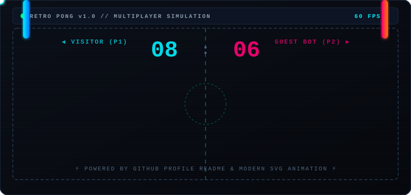

  <!-- Dynamic Typing Header -->
  

    

  <!-- Interactive Retro Ping Pong Arcade Section -->
  <h3>🕹️ RETRO PING PONG ARCADE // LIVE MATCH</h3>
  
<i>Saksikan duel ping-pong otomatis di bawah, atau klik tombol untuk mulai bermain!</i>

  <!-- Embed Pong SVG -->
  

   

  <!-- Interactive Game Controls / Links -->
  

    
    &nbsp;
    
    &nbsp;
    
  

### 🐍 Contribution Snake Eater

  

### 📊 GitHub Stats & Streak

  
  &nbsp;
  

 

  

### 💻 Tech Stack & Tools

  

  
⭐ <i>Thanks for stopping by! Don't forget to star my repositories if you find something useful.</i> ⭐

